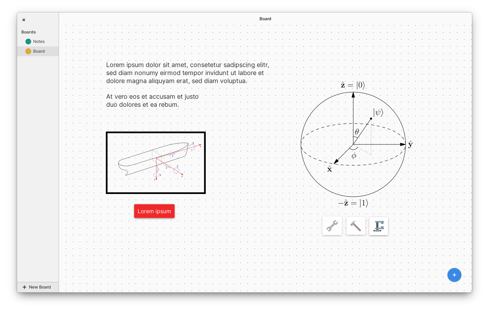
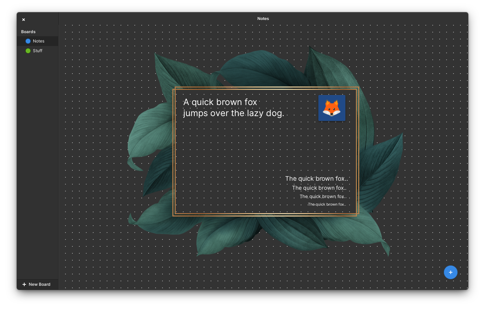

# Moobo

## Visualize your ideas on moodboards

Use different widgets to visualize your thoughts.

⚠ NOTE: Moobo was developed as part of my bachelors degree. At this point, consider Moobo as proof of concept.

### Credits

Moobo is developed after a concept by [Heru Setiawan](https://hrstwn.github.io/). Heru Setiawan is an illustrator who came up with the idea of the app. The original mockup can be found on [reddit](https://www.reddit.com/r/elementaryos/comments/kg5uiw/moobo_is_a_moodboarding_and_notetaking_app/).

Run `meson build` to configure the build environment. Change to the build directory and run `ninja` to build

    meson build --prefix=/usr
    cd build
    ninja

To install, use `ninja install`, then execute with `io.elementary.photos`

    sudo ninja install
    io.elementary.photos
